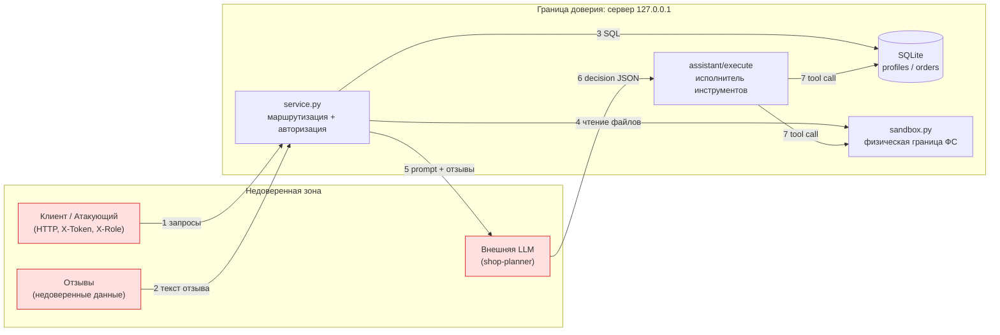

# Модель угроз — Mini Shop (практика 6)

Методика по ориентиру Microsoft Threat Modeling: **описание системы → границы
доверия → угрозы (STRIDE) → меры → проверка**.

## 1. Описание системы

Mini Shop — локальный HTTP-сервис (stdlib Python, SQLite в памяти) с AI-помощником.
Хранит учебные профили (ПДн), заказы, чеки в файловом стенде и исполняет
«решения» LLM через инструменты `read_file / export_profiles / delete_tree`.

## 2. Контекст и границы доверия (DFD)

Ключевые границы доверия, которые пересекают данные:
- **① вход HTTP** — клиент не доверен; заголовки `X-Token`/`X-Role` подконтрольны ему.
- **② отзывы** — пользовательский контент, который позже попадает в HTML и в prompt LLM.
- **⑥ решение LLM** — *не* авторитетный источник: сервер обязан перепроверять права.
- **⑦ инструменты** — действия над БД и ФС должны ограничиваться правами вызвавшего клиента.

## 3. Угрозы по STRIDE

| STRIDE | Угроза | Где | Отчёт |
|---|---|---|---|
| **S** Spoofing | Подмена роли заголовком `X-Role: staff` | `/admin/export` | #6 |
| **T** Tampering | Подмена цены заказа; SQL-инъекция меняет выборку | `/orders`, `/profile`, `/search` | #5, #1–3 |
| **R** Repudiation | Логи содержат секреты, но открыты всем → нет контроля доступа к аудиту | `/debug/logs` | #11 |
| **I** Info Disclosure | Дамп ПДн, чужие чеки, секрет оператора, тексты исключений | `/search`, `/files`, `/profile`, 500 | #1,2,7,12 |
| **D** Denial of Service | `delete_tree(".")` уничтожает учебные файлы | `/assistant/execute` | #8 |
| **E** Elevation of Priv. | Клиент исполняет staff-инструменты и читает чужое через помощника | `/assistant/execute`, `X-Role` | #6, #8 |
| **Prompt injection** | Отзыв-инструкция управляет действиями помощника | `reviews → context → execute` | #8, #10 |

## 4. Меры защиты (реализованы в `service.py`)

1. **Аутентификация по серверной сессии** на всех чувствительных маршрутах; роль
   и владелец берутся только из сессии (`X-Role` игнорируется).
2. **Параметризованный SQL** везде — инъекции через `id`/`q`/`order_id` закрыты.
3. **Авторизация по владельцу** (профиль, заказы, чеки, контекст помощника только
   свои; staff — шире).
4. **Цена только из каталога** — клиентская цена игнорируется.
5. **Контроль доступа внутри стенда**: `allowed_read` запрещает `..`/`.`, доступ в
   `private/` и чужие `files/<user>/` для клиентов.
6. **Исполнитель инструментов перепроверяет права** независимо от решения LLM;
   `delete_tree` недоступен через API, `export_profiles` — только staff.
7. **Экранирование HTML** отзывов (XSS), **промпт помечает отзывы как данные**.
8. **`/debug/logs` — только staff**, логи без тел и заголовков (нет паролей/токенов).
9. **500 без деталей** исключения.

## 5. Проверка

`test_security.py` — регрессионные тесты на каждую угрозу (падают на исходной
версии, проходят на исправленной). Принудительная отправка опасного `decision` в
`/assistant/execute` показывает, что защита сервера не зависит от послушания LLM.
Функциональные тесты (`test_service.py`, `test_http.py`) по-прежнему зелёные.
